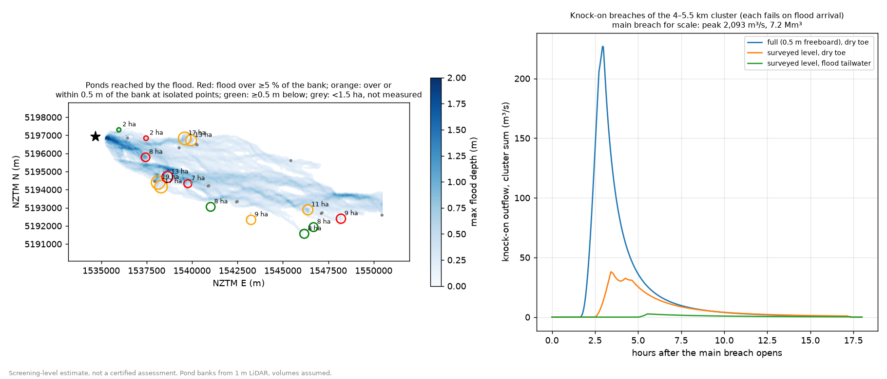

# Knock-on failure of other ponds in the flood path – exploratory evidence note

**Status: exploratory, not part of the published results.** Nothing in the main pipeline (scripts 01–10),
`config/dam.yaml`, the viewers or `RESULTS.md` depends on this. Screening model, not a certified assessment.

**Question (CLG, Oct 2026):** a breach of the Wrights Road ponds sends water across farmland that holds other ponds,
reservoirs and effluent ponds. Could the flood damage those and make them fail too, and would that change the
flood picture significantly?

## Answer in brief

* **The domino that matters most is already in the model.** The east, south and north scenarios are a cascade
  (Pond 1 fails into Pond 2, which then fails outward), and the earthquake scenario fails every embankment,
  including the dividing one, at once (SPEC §3.1 items 5 and 7).
* **Ponds further downstream add little.** The east flood reaches 30 mapped water bodies. The five that matter are
  13–19 ha reservoirs and effluent ponds 4.3–5.3 km downstream, reached 1.2–1.4 h after the breach opens. Their
  water stands only 0–1.2 m above the ground outside their banks. Water below ground level stays in the pond
  even if a bank fails.
* **Rough knock-on estimate for those five** (each failing as soon as the flood reaches it):
  * as surveyed (most likely): **0.47 Mm³ released, combined peak ~40 m³/s**;
  * all five full to 0.5 m below their bank crest (upper bound): **1.45 Mm³, ~230 m³/s**;
  * with the flood standing around them (it pushes back on the banks): **0.04 Mm³, ~3 m³/s**.
  For scale, the main east breach releases **7.2 Mm³ at a peak of ~2,100 m³/s**. The knock-on water comes after
  the flood front and the peak have passed, so it lengthens the tail locally rather than raising peak depths.
* **The flood does top some banks.** On the 1 m LiDAR, one 12.7 ha reservoir in the group has the peak flood above
  its bank along about a third of its length (by up to ~0.7 m). The other four are topped only at isolated low
  points, or not at all. A bank overtopped for hours at 1–2 m/s could erode. So a knock-on failure there is
  credible, but it is small next to the main flood.
* **Where it could matter:** two of the five are mapped as wastewater ponds. If they failed or were flooded, the
  breach water would carry effluent. That is a health and clean-up issue rather than a depth issue.

**Message for the CLG:** knock-on failures of farm ponds downstream would not change the flood extent or the
arrival times in any significant way: at most about one-fifth more water, released later and more slowly.
Contamination from the effluent ponds is the consequence worth raising with WDC/ECan.

## Method

Run: `python scripts/18_downstream_ponds.py --scenario east --root <checkout with data/ and the 2D .tif outputs>`
(about a minute; it fetches a small 1 m LiDAR patch per pond into `data/raw/lidar_ponds/`). Outputs go to
`outputs/downstream_ponds/east/`: `ponds.csv` (every wetted water body), `knockon.csv` (per pond and case),
`knockon_hydrographs.csv`, `summary.json`, `downstream_ponds.png`.

1. **Which ponds.** OSM `natural=water` / `landuse=reservoir` polygons (`data/raw/osm_domain.gpkg`, layer
   `water`), duplicates removed, that the east shakedown max-depth raster wets by ≥ 0.05 m within 60 m.
   This gives 30 water bodies. The 15 that are 1.5 ha or larger are measured; the other 15 total 2.4 ha.
2. **Banks, measured on the 1 m LiDAR DEM** (LINZ Canterbury 2020–23, the same source as the model terrain):
   * pond level = median DEM inside the outline (the water surface at the time of the survey);
   * bank crest = highest cell within 12 m of each point on the outline, every 5 m;
   * outside ground = median DEM 25–45 m outside the outline.
3. **Overtopping.** At each crest point, the peak flood level next to it (2D bed + max depth, highest value within
   40 m outside the bank) is compared with the crest. A pond counts as overtopped when the flood tops the crest
   along ≥ 5 % of the bank. Isolated low points are reported but treated as uncertain: they are often ramps,
   inlets or LiDAR edge effects.
4. **Knock-on breach.** The same level-pool routing and Froehlich (2008) overtopping breach as script 03
   (`damflood.breach`). The pond is treated as vertical-sided, and only water above the breach invert is released.
   Three cases:
   * *surveyed level, dry toe*: pool at the surveyed water level, breach down to the outside ground;
   * *full, dry toe*: pool 0.5 m below the lowest crest (upper bound);
   * *surveyed level, flood tailwater*: breach invert raised to the median flood level outside, a crude stand-in
     for the flood pushing back on the bank.

   Each pond fails at the moment the flood first reaches it, which is pessimistic. The Froehlich (1995) peak
   check agrees with the routed peaks to within 10 %.

## Results (east breach, shakedown 20 m run)

Ponds ≥ 1.5 ha reached by the flood. *Arrival* is in hours after the main breach opens. *Head* is the pond level
minus the outside ground; a negative value means the pond is dug in. *Margin* is the lowest crest minus the flood
level next to it (negative = overtopped there). *% bank* is the share of bank length the flood tops. *Perched
volume* is the water above outside ground, as surveyed / full.

| Kind (OSM) | Area (ha) | Distance (km) | Arrival (h) | Max depth / speed outside (m, m/s) | Bank height (m) | Head (m) | Margin (m) | % bank topped | Perched volume (Mm³) |
|---|---|---|---|---|---|---|---|---|---|
| basin | 1.8 | 1.3 | 0.9 | 0.9 / 1.2 | 2.7 | −1.4 | 0.9 | 0 | 0 / 0.04 |
| basin | 2.2 | 2.8 | 1.0 | 0.5 / 1.2 | 1.8 | −0.8 | −0.2 | 12 | 0 / 0.03 |
| basin | 7.8 | 3.0 | 0.8 | 1.2 / 1.9 | 1.9 | 0.0 | −5.7 ¹ | 41 | 0 / 0.10 |
| **reservoir** | **19.2** | **4.3** | 1.2 | 1.3 / 1.4 | 2.4 | 0.5 | 0.1 | 0 | 0.10 / 0.35 |
| **reservoir** | **16.9** | **4.5** | 1.4 | 0.7 / 1.0 | 2.7 | 1.2 | −0.45 | 2 | 0.21 / 0.34 |
| **reservoir** | **12.7** | **4.5** | 1.2 | 1.6 / 2.3 | 1.7 | 0.7 | −0.68 | **34** | 0.09 / 0.14 |
| **wastewater** | **16.9** | **4.9** | 1.3 | 0.9 / 1.5 | 2.5 | 0.6 | 0.22 | 0 | 0.10 / 0.34 |
| **wastewater** | **12.7** | **5.3** | 1.4 | 0.7 / 1.3 | 2.9 | 0.0 | −1.4 ¹ | 3 | 0 / 0.30 |
| pond | 6.7 | 5.7 | 1.4 | 1.3 / 1.9 | 3.0 | 1.4 | −1.2 ¹ | 7 | 0.09 / 0.14 |
| basin | 8.2 | 7.4 | 2.0 | 0.4 / 1.1 | 2.8 | 0.6 | 2.1 | 0 | 0.05 / 0.18 |
| reservoir | 9.3 | 9.7 | 2.9 | 0.3 / 0.2 | 3.0 | 1.5 | 0.14 | 0 | 0.14 / 0.20 |
| pond | 10.9 | 12.4 | 2.9 | 0.8 / 1.1 | 2.5 | 0.4 | −0.46 | 1 | 0.04 / 0.21 |
| basin | 8.5 | 12.7 | 3.5 | 0.4 / 0.6 | 2.4 | 0.7 | 0.73 | 0 | 0.06 / 0.15 |
| basin | 8.3 | 13.0 | 3.8 | 0.3 / 0.5 | 3.0 | 0.6 | 0.94 | 0 | 0.05 / 0.20 |
| reservoir | 9.1 | 14.3 | 3.6 | 0.4 / 0.5 | 2.1 | −0.2 | −1.7 ² | 34 | 0 / 0 |

¹ Margins below about −1 m at a few points are most likely a gap in the bank (inlet, ramp or spillway) or a
20 m-grid edge effect, not a 1–6 m overtopping. The *% bank* column is the better guide.
² The OSM outline does not follow this pond's bank (the lowest "crest" equals the water level). The pond is dug
in, and nothing is released.

Ponds with zero or negative head are dug in: the flood can fill them but cannot make them release anything.
Several of the "basins" are like this, and they act as small extra storage that slightly delays the flood.

**Knock-on breaches, 4–5.5 km group (bold rows):**

| Case | Water released (Mm³) | Combined peak (m³/s) | When (h after main breach) | Single-pond peaks (m³/s) |
|---|---|---|---|---|
| Surveyed level, dry toe | 0.47 | 38 | 3.4 | 0–30 |
| Full (0.5 m freeboard), dry toe | 1.45 | 227 | 3.0 | 21–67 |
| Surveyed level, flood tailwater | 0.04 | 3 | 5.6 | 0–3 |
| *Main east breach, for scale* | *7.18* | *2,093* | *1.1* | |

Breach formation times are 1.3–4.2 h and final bottom widths 10–20 m. These are small breaches, as expected for
1–2 m of head.

## Caveats

* **The pond outlines come from OSM.** Some are mapped twice or follow the fence rather than the bank. The pond
  types (reservoir / wastewater / basin) are as tagged by mappers and have not been checked on the ground.
* **The pond levels are from one LiDAR survey (2020–23).** Ponds may be fuller or emptier on the day of a breach;
  the "full" case brackets that. The depth of the dug-in part is unknown, but it does not matter because that
  water cannot leave.
* **The flood levels come from the 20 m shakedown run,** where the ponds are just terrain, so flood water fills
  them as if they were hollows. Bank crests (1 m) are much sharper than the 20 m flood grid, so overtopping at
  single points is uncertain.
* **The knock-on hydrographs are not fed back into the 2D model.** The effect on depths downstream is judged by
  scale (≤ 11 % of the main peak, released after it), not modelled. Feeding them back would need extra inlets in
  script 04, similar to the `quake` multi-breach set-up.
* **Only the east scenario has been screened.** The north and south floods cross different farmland and can be
  screened with `--scenario north|south` once their max-depth rasters exist in the root checkout.
* **What would replace this:** pond consents and as-built levels from ECan (consented volumes, bank crest
  levels, effluent pond lining and spillways), and a field check of the five ponds at 4–5.5 km.
